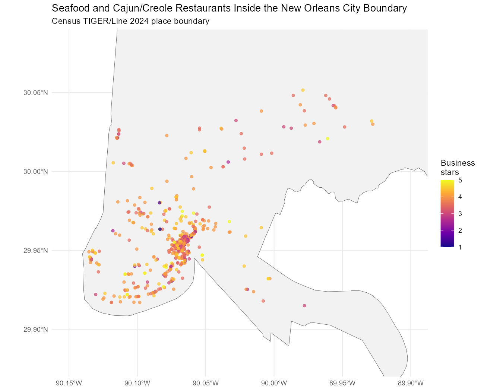
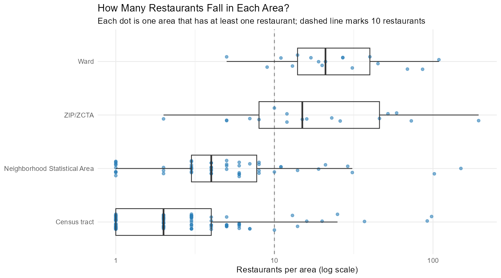
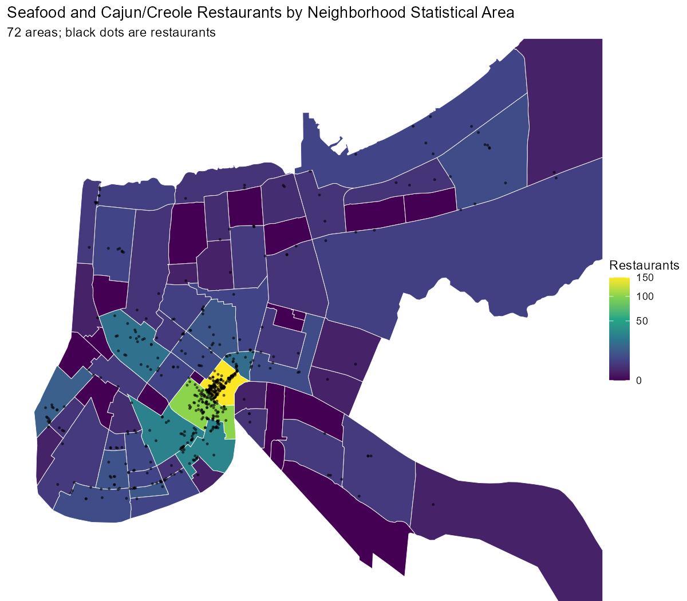
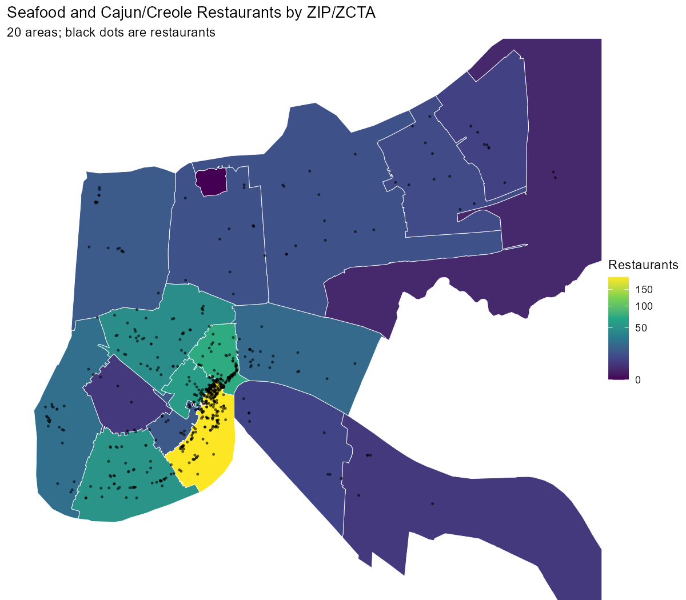
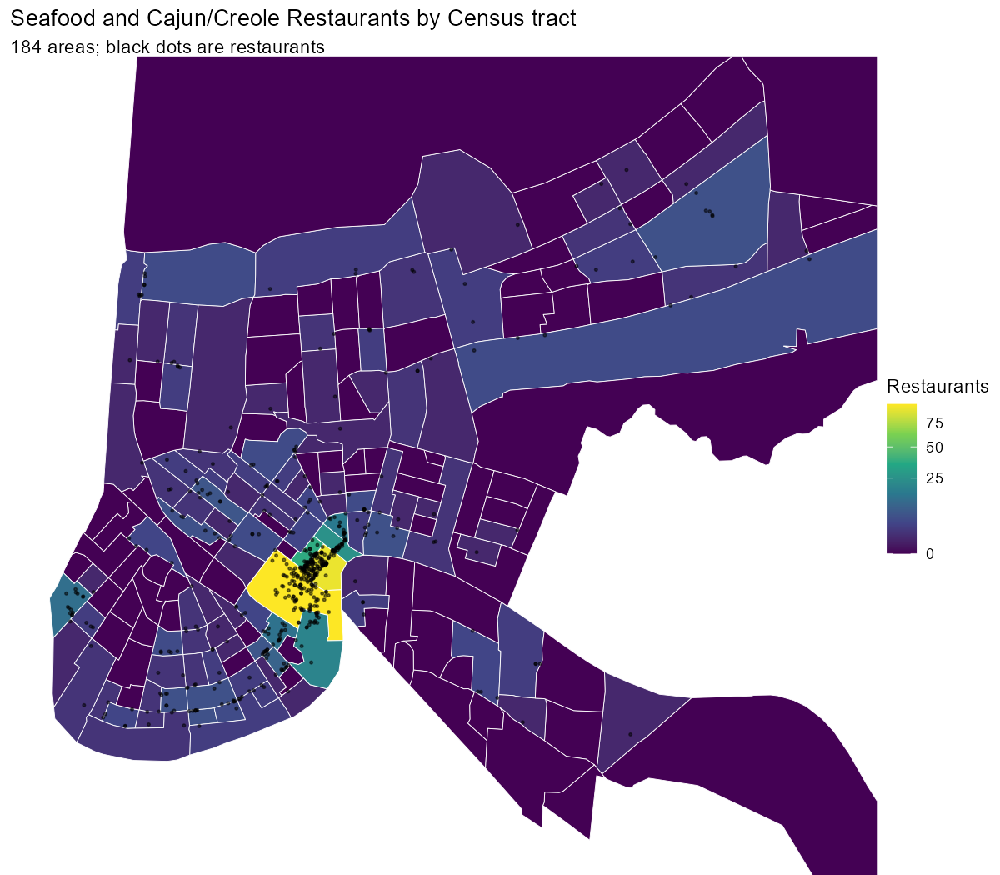
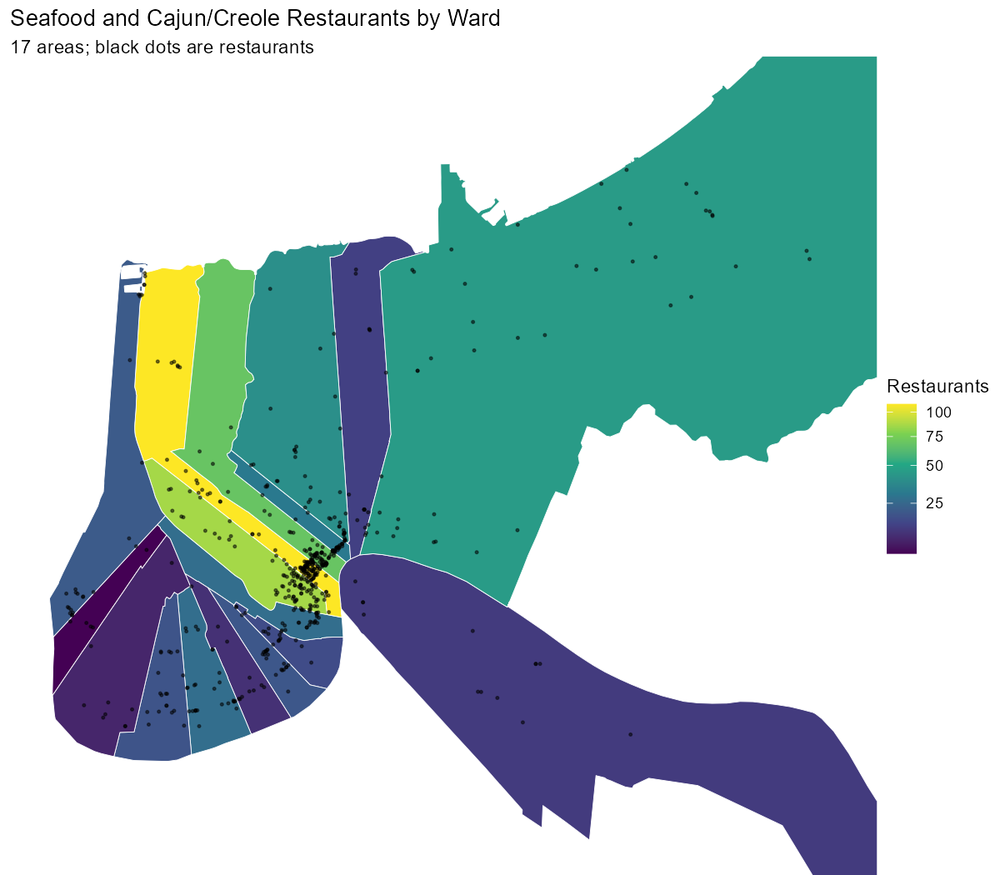
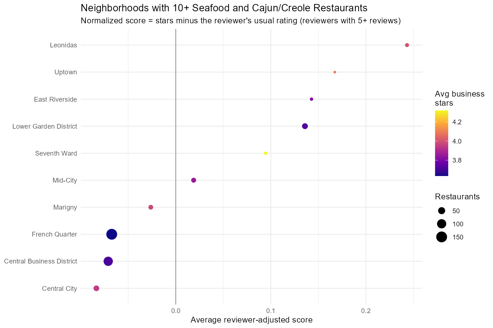

# Choosing a Geographic Area for New Orleans Seafood and Cajun/Creole Restaurants

## Choice: Neighborhood Statistical Areas

I am using the City of New Orleans **Neighborhood Statistical Areas** (72 neighborhoods) for the main analysis. ZIP codes are used as a check.

Why:

1. **They match the question.** The question is where a visitor should go for seafood and Cajun/Creole food. People plan trips by neighborhood (French Quarter, Marigny, Uptown), not by ZIP code, census tract, or ward number.
2. **There are enough restaurants to compare.** 10 neighborhoods have at least 10 restaurants, more than the 7 required. All 565 restaurants are matched to a neighborhood.
3. **They split up the tourist center.** The French Quarter and Central Business District are separate neighborhoods. ZIP 70130 puts 194 restaurants (about a third of the total) in one area, which hides differences inside it.
4. **The boundaries are documented.** They come from the City of New Orleans and are built from census tracts.

Tradeoff: 29 neighborhoods have fewer than 5 restaurants. Their averages are not reliable, so only neighborhoods with 10 or more restaurants are ranked.

## Data used

| Step | Result |
|---|---:|
| Seafood, Cajun/Creole, or Seafood Markets restaurants (Yelp city = New Orleans) | 578 |
| Reviews for those restaurants | 225,209 |
| Reviewers | 129,408 |
| Restaurants inside the official Census city boundary | 565 |
| Restaurants outside the boundary (dropped) | 13 |

The 13 dropped restaurants are mostly in ZIP codes 70121 and 70123. Their mailing address says "New Orleans", but they are in Jefferson Parish (Elmwood, Harahan, Jefferson). Across all New Orleans restaurants, 57 Yelp "New Orleans" restaurants fall outside the city boundary.

## Comparison of geographic systems

| Geographic system | Number of areas | Areas with restaurants | Areas with 10+ | Areas with under 5 | Restaurants assigned | Unmatched | Smallest area count | Largest area count | Median area count |
|---|---:|---:|---:|---:|---:|---:|---:|---:|---:|
| ZIP/ZCTA | 20 | 17 | 12 | 1 | 565 | 0 | 2 | 194 | 15 |
| Census tract | 184 | 105 | 9 | 81 | 565 | 0 | 1 | 98 | 2 |
| Neighborhood Statistical Area | 72 | 54 | 10 | 29 | 565 | 0 | 1 | 150 | 4 |
| Ward | 17 | 17 | 15 | 0 | 563 | 2 | 5 | 109 | 21 |

- **Census tracts** are too small. The median tract has 2 restaurants, and 81 tracts have fewer than 5.
- **Wards** have the most stable counts, but "Ward 4" means nothing to a visitor. Two restaurants on the edge of the city did not fall inside any ward.
- **ZIP codes** are stable and familiar, but one ZIP holds a third of the restaurants.
- **Neighborhoods** balance useful names against enough restaurants per area.

### Maps

| | |
|---|---|
|  |  |
|  |  |

## Preliminary results by neighborhood

Normalized score = a review's stars minus that reviewer's average stars across all seafood and Cajun/Creole reviews. Only reviewers with 5 or more reviews in this group are used. A positive score means reviewers rated restaurants there higher than they usually do.

| Neighborhood | Restaurants | Avg business stars | Total reviews | Eligible reviews | Avg normalized score |
|---|---:|---:|---:|---:|---:|
| Leonidas | 14 | 4.00 | 4,367 | 1,356 | 0.24 |
| Uptown | 10 | 4.10 | 1,891 | 712 | 0.17 |
| East Riverside | 11 | 3.82 | 5,957 | 1,686 | 0.14 |
| Lower Garden District | 31 | 3.73 | 13,301 | 3,093 | 0.14 |
| Seventh Ward | 11 | 4.32 | 1,505 | 356 | 0.09 |
| Mid-City | 21 | 3.86 | 6,596 | 2,052 | 0.02 |
| Marigny | 19 | 3.97 | 5,952 | 1,293 | -0.03 |
| French Quarter | 150 | 3.64 | 89,823 | 15,984 | -0.07 |
| Central Business District | 102 | 3.72 | 55,534 | 11,081 | -0.07 |
| Central City | 29 | 3.95 | 6,118 | 1,567 | -0.08 |

The French Quarter has the most restaurants and reviews, but it ranks near the bottom after adjusting for reviewer habits. Uptown neighborhoods (Leonidas, Uptown, East Riverside) rank highest. The ZIP code results agree: 70118 (Uptown/Leonidas) ranks near the top, and 70130 and 70112 (French Quarter/downtown) are below zero.

## Code

- [R/reviews.R](R/reviews.R): Step 4, joins reviews to the selected restaurants
- [R/spatial.R](R/spatial.R): Step 5, spatial join with the Census city boundary
- [R/geography.R](R/geography.R): Step 6, compares the four systems and makes the maps

## Sources

- [Yelp Open Dataset](https://business.yelp.com/data/resources/open-dataset/): business and review JSON files
- [Census TIGER/Line](https://www.census.gov/geographies/mapping-files/time-series/geo/tiger-line-file.html): 2024 places and tracts, 2020 ZCTAs, downloaded with [`tigris`](https://walker-data.com/tigris/)
- [Neighborhood Statistical Areas](https://maps.nola.gov/server/rest/services/Reference/Reference_Layers/MapServer/0): City of New Orleans GIS
- [Wards](https://maps.nola.gov/server/rest/services/Administrative/Administrative_Layers/MapServer/3): City of New Orleans GIS
