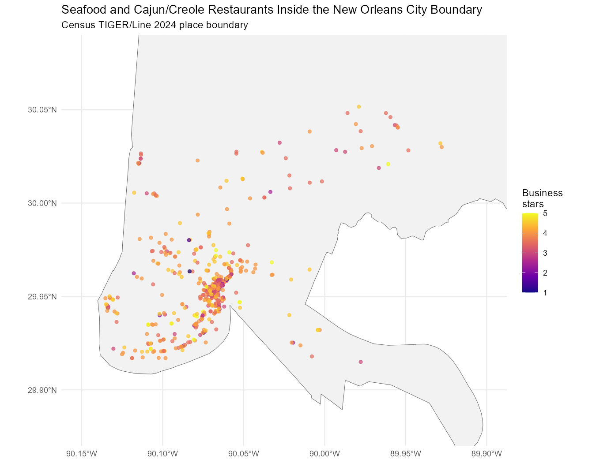
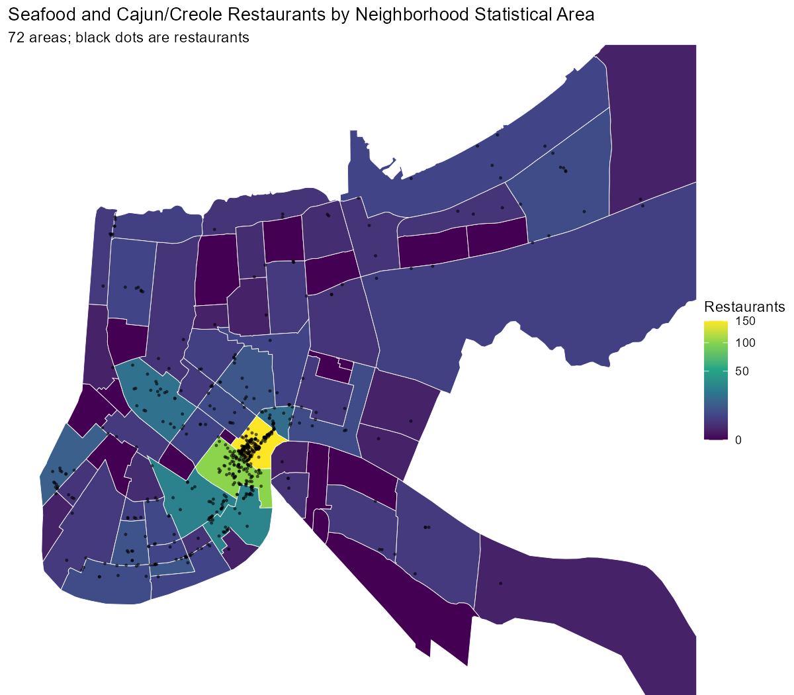
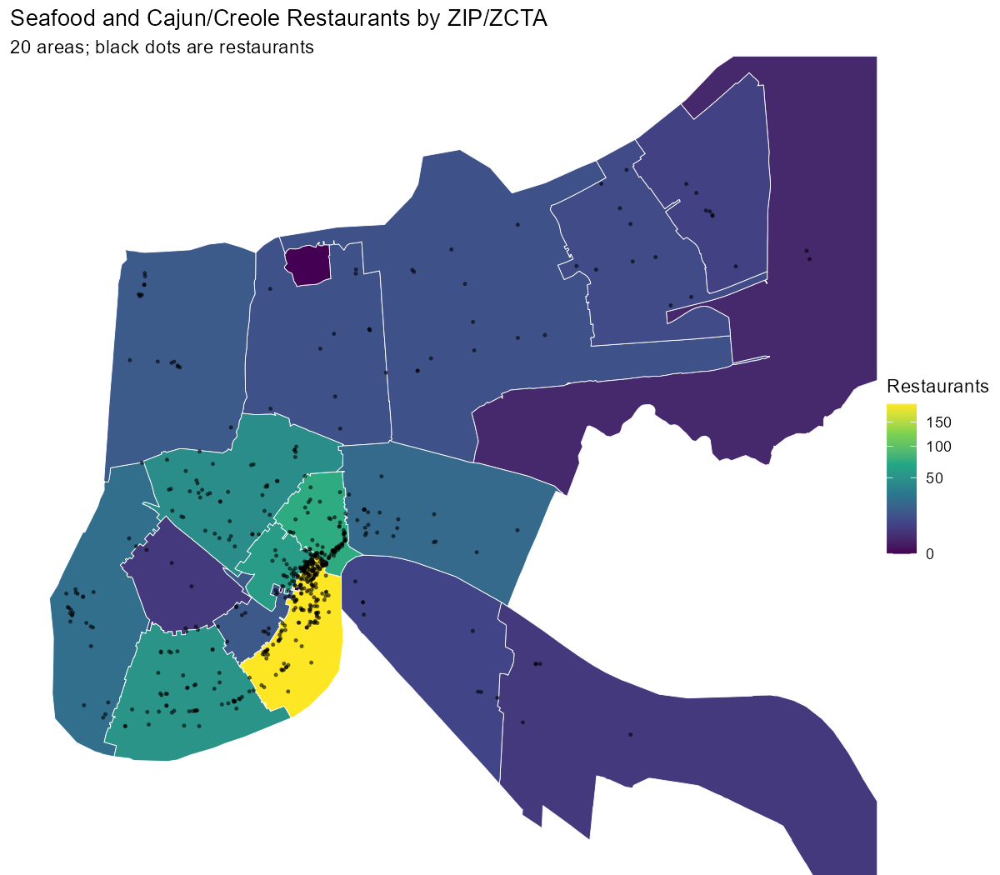
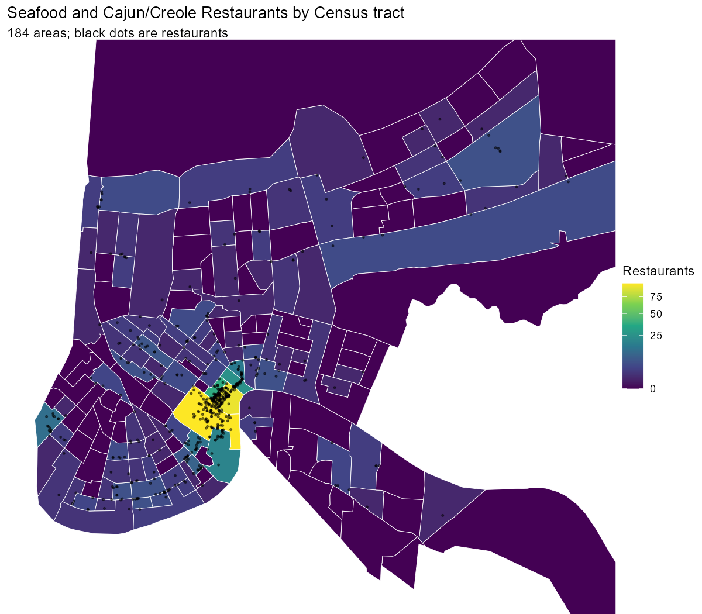
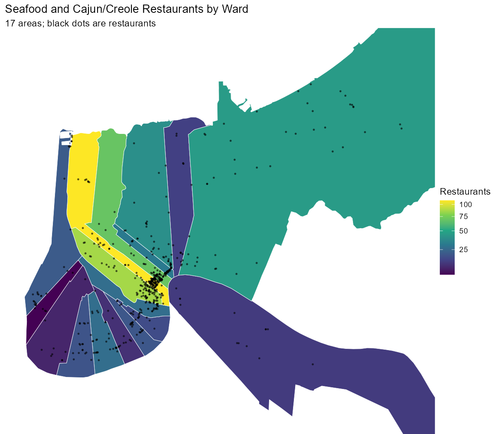
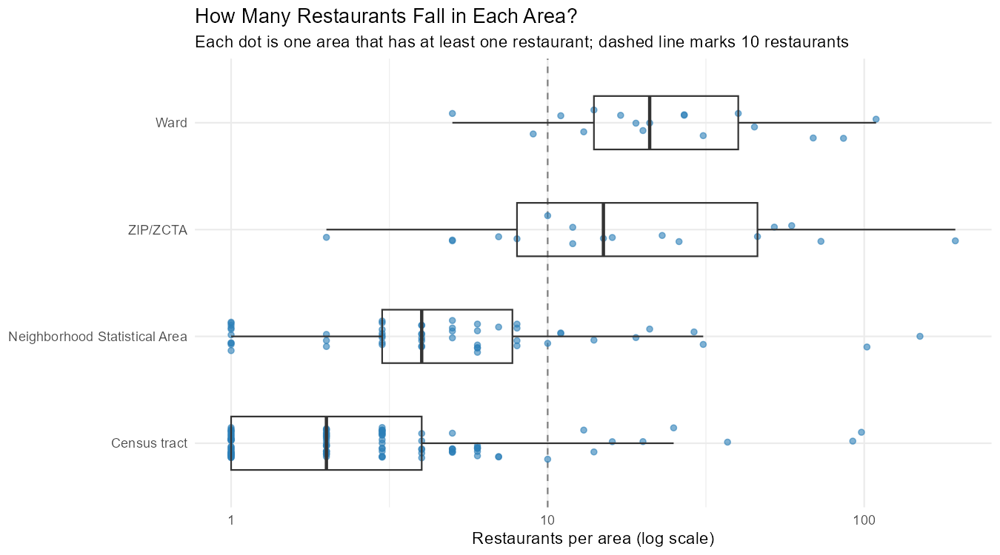

```{r}
#| label: setup
#| echo: false
library(tidyverse)
library(knitr)

show_table <- function(df, digits = 2) {
  kable(df, digits = digits, format.args = list(big.mark = ","))
}
```

## Research question

> **Where can someone find the best seafood and Cajun/Creole restaurants in New Orleans, and which neighborhood is best for finding them?**

## Executive summary

I used the Yelp Open Dataset to study 565 seafood and Cajun/Creole restaurants inside the New Orleans city limits and their 224,050 reviews. "Best" is measured with a reviewer-adjusted score: each review's stars minus that reviewer's usual rating. This rewards restaurants that make reviewers happier than they normally are, instead of restaurants that attract easy graders.

**Leonidas** (the Carrollton/Riverbend area Uptown) is the best neighborhood. It ranks first among the 10 neighborhoods with 10 or more of these restaurants, with or without the reviewer adjustment and at every reviewer threshold I tested. The French Quarter has the most choices (150 restaurants) and two of the top 10, but its typical restaurant is rated *below* what its reviewers usually give.

**The top restaurant is Avery's On Tulane**, followed by Jaidyn's Wing Stop/Food For The Soul and Tito's Ceviche & Pisco.

## The answer: top 10 restaurants

```{r}
#| label: run-everything
#| echo: false
#| results: hide
source("R/categories.R")
source("R/reviews.R")
step4_reviews <- category_reviews
source("R/spatial.R")
source("R/geography.R")
source("R/analysis.R")
results <- readRDS("output/analysis_results.rds")
```

A restaurant is ranked only if at least 20 of its reviews come from "eligible" reviewers: people who wrote 5 or more seafood/Cajun reviews, so their usual rating is known.

```{r}
#| label: top-10
#| echo: false
results$top_10_restaurants |>
  transmute(
    Rank = rank,
    Restaurant = business_name,
    Neighborhood = area_name,
    `Yelp stars` = stars,
    `Avg stars (all reviewers)` = average_stars_all_reviewers,
    `Reviews (all)` = number_of_reviews_all_reviewers,
    `Reviews (eligible)` = number_of_reviews_eligible_reviewers,
    `Adjusted score` = average_normalized_score,
    `Rank before adjustment` = raw_rank
  ) |>
  show_table()
```


## Data and workflow

| File | What it does |
|---|---|
| [R/import.R](https://github.com/haithamassaf/yelp-new-orleans-project/blob/main/R/import.R) | Steps 1–2: streams the raw JSON, filters to New Orleans restaurants, saves RDS |
| [R/categories.R](https://github.com/haithamassaf/yelp-new-orleans-project/blob/main/R/categories.R) | Step 3: category counts, co-occurrence, selection |
| [R/reviews.R](https://github.com/haithamassaf/yelp-new-orleans-project/blob/main/R/reviews.R) | Step 4: joins reviews to the selected restaurants |
| [R/spatial.R](https://github.com/haithamassaf/yelp-new-orleans-project/blob/main/R/spatial.R) | Step 5: spatial join with the Census city boundary |
| [R/geography.R](https://github.com/haithamassaf/yelp-new-orleans-project/blob/main/R/geography.R) | Step 6: compares four geographic systems |
| [R/analysis.R](https://github.com/haithamassaf/yelp-new-orleans-project/blob/main/R/analysis.R) | Step 7: reviewer-adjusted scores, top 10, final map |

Packages: `tidyverse`, `jsonlite`, `lubridate`, `sf`, `tigris`, `scales`, `viridis`, plus `ggrepel` (map and chart labels) and `knitr` (tables).

Data sources:

- [Yelp Open Dataset](https://business.yelp.com/data/resources/open-dataset/): `yelp_academic_dataset_business.json` and `yelp_academic_dataset_review.json`
- [Census TIGER/Line](https://www.census.gov/geographies/mapping-files/time-series/geo/tiger-line-file.html) via [`tigris`](https://walker-data.com/tigris/): 2024 places and tracts, 2020 ZCTAs
- City of New Orleans GIS: [Neighborhood Statistical Areas](https://maps.nola.gov/server/rest/services/Reference/Reference_Layers/MapServer/0) and [Wards](https://maps.nola.gov/server/rest/services/Administrative/Administrative_Layers/MapServer/3)

## Large-data management

The Yelp download was far bigger than anything we used in class:

| Item | Size |
|---|---:|
| Downloaded zip (`Yelp-JSON.zip`) | 4.35 GB |
| `yelp_academic_dataset_review.json` | 5.3 GB, 6,990,280 reviews |
| `yelp_academic_dataset_business.json` | 119 MB, 150,346 businesses |
| Final Louisiana restaurant reviews (`reviews_new_orleans.rds`) | 95 MB |
| Final seafood/Cajun reviews without text (`selected_reviews.rds`) | 7 MB |

Problems and how I handled them:

1. **The tar file would not open.** The zip held a `.tar` that Windows cannot open by double-clicking. My first `tar -xf` failed with "Archive is compressed", so the file was actually gzip-compressed and needed `tar -xzf`.
2. **Disk space.** Unzipping everything would write the 4.35 GB tar plus 8.65 GB of JSON. Instead I streamed the tar straight out of the zip and extracted only the two files I needed (5.4 GB), skipping the user, check-in, and tip files.
3. **Memory.** Reading 7 million reviews into one data frame needs many gigabytes of RAM. `jsonlite::stream_in()` with a `handler` reads 100,000 lines at a time and keeps only reviews for Louisiana restaurants (558,340) before reading the next page, so the full file never sits in memory. The whole import took about 8 minutes.
4. **Only needed columns.** The business file kept 11 columns, and the analysis copy of the reviews drops the long `text` column.
5. **Compressed outputs.** Everything is saved as `xz`-compressed RDS. After saving, I deleted the 5.4 GB of extracted JSON.
6. **GitHub limits.** GitHub's website rejects uploads over 25 MB, and git rejects files over 100 MB. The raw JSON and the 95 MB review file are in `.gitignore`. Everything this report needs (`selected_reviews.rds`, 7 MB) is in the repository.

## Steps 1–2: Import and filter to New Orleans

```{r}
#| label: import-code
#| eval: false
#| file: R/import.R
```

```{r}
#| label: import-results
#| echo: false
business_new_orleans <- readRDS("data/new_orleans/business_new_orleans.rds")
business_la <- readRDS("data/new_orleans/business_la_restaurants.rds")

tibble(
  Step = c("All Yelp businesses", "Louisiana restaurants", "New Orleans restaurants",
           "Reviews in the full file", "Reviews for Louisiana restaurants"),
  Count = c(150346, nrow(business_la), nrow(business_new_orleans), 6990280, 558340)
) |>
  show_table()
```

A **New Orleans restaurant** has `state == "LA"`, the word "Restaurants" in its `categories`, and a Yelp `city` of New Orleans. The city label is cleaned first (capitalization and extra spaces), which recovered 2 restaurants an exact match would have missed. None of the 2,261 restaurants are missing coordinates or categories. In Step 5 this text label is checked against the official city boundary.

## Step 3: Choosing related categories

```{r}
#| label: categories-code
#| eval: false
#| file: R/categories.R
```

The most common categories among New Orleans restaurants:

```{r}
#| label: category-counts
#| echo: false
category_counts |>
  slice_head(n = 15) |>
  rename(Category = category, Restaurants = number_of_restaurants) |>
  show_table()
```

I chose **Seafood**, **Cajun/Creole**, and **Seafood Markets**. They belong together because seafood is the core of Cajun and Creole cooking (gumbo, étouffée, po-boys, boiled crawfish), and seafood markets in New Orleans often serve ready-to-eat boiled seafood. Yelp has no separate "Cajun" or "Creole" tag, only the combined "Cajun/Creole".

The co-occurrence counts support the grouping. Cajun/Creole and Seafood appear together more often than either appears with any other cuisine:

```{r}
#| label: category-pairs
#| echo: false
category_pairs |>
  filter(category_1 %in% selected_categories | category_2 %in% selected_categories) |>
  slice_head(n = 10) |>
  rename(`Category 1` = category_1, `Category 2` = category_2, `Restaurants with both` = restaurants_with_both) |>
  show_table()

category_pairs |>
  filter(category_1 %in% selected_categories, category_2 %in% selected_categories) |>
  rename(`Category 1` = category_1, `Category 2` = category_2, `Restaurants with both` = restaurants_with_both) |>
  show_table()
```

21 of the 22 seafood markets are also tagged Seafood, and the rest are tagged Cajun/Creole.

**Inclusion rule:** a restaurant is included if it has **at least one** of the three categories.

```{r}
#| label: category-summary
#| echo: false
selected_restaurants |>
  summarise(
    Restaurants = n(),
    Seafood = sum(`seafood`),
    `Cajun/Creole` = sum(`cajun/creole`),
    `Seafood Markets` = sum(`seafood markets`),
    `Two or more categories` = sum(categories_matched >= 2),
    `Average stars` = mean(stars),
    `Total reviews` = sum(review_count)
  ) |>
  show_table()
```

The group spreads across the city: 12 ZIP codes and 10 neighborhoods each have at least 10 of these restaurants (Step 6), more than the required 7 areas.

## Step 4: Joining businesses to reviews

```{r}
#| label: reviews-code
#| eval: false
#| file: R/reviews.R
```

Reviews were filtered to the selected restaurants with `semi_join()` before any further work, so reviews for thousands of unrelated businesses are not carried through the analysis. The tables are linked by `business_id` (one restaurant to many reviews).

```{r}
#| label: reviews-results
#| echo: false
step4_reviews |>
  summarise(
    Reviews = n(),
    Reviewers = n_distinct(user_id),
    `Restaurants with reviews` = n_distinct(business_id),
    `First review` = as.character(min(review_date)),
    `Last review` = as.character(max(review_date)),
    `Average stars` = mean(stars)
  ) |>
  show_table()
```

The review file has slightly more reviews (225,209) than the sum of Yelp's `review_count` field (220,858). The two fields were probably updated at slightly different times.

## Step 5: Spatial join with the official city boundary

```{r}
#| label: spatial-code
#| eval: false
#| file: R/spatial.R
```

The Yelp `city` field is a mailing label. The Census TIGER/Line place boundary is the legal city limit. Comparing them for all 3,640 Louisiana restaurants:

```{r}
#| label: city-check
#| echo: false
city_check |>
  rename(`Yelp says New Orleans` = yelp_says_new_orleans,
         `Inside Census New Orleans boundary` = census_says_new_orleans,
         Restaurants = n) |>
  show_table()
```

The 57 mismatches with a Yelp city of New Orleans are not errors to delete. Most are in ZIP codes 70121 and 70123, where the post office uses "New Orleans" even though the area is in Jefferson Parish (Elmwood, Harahan, Jefferson, River Ridge):

```{r}
#| label: mismatches
#| echo: false
restaurants_with_place |>
  st_drop_geometry() |>
  filter(city_clean == "New Orleans", place_name != "New Orleans") |>
  count(`Census place` = place_name, `ZIP code` = postal_code, name = "Restaurants", sort = TRUE) |>
  slice_head(n = 8) |>
  show_table()
```

For the seafood and Cajun/Creole group, **565 of 578 restaurants are inside the city boundary**. I used the stricter boundary-based definition from here on, so every restaurant can be assigned to a city neighborhood.



## Step 6: Choosing a geographic system

```{r}
#| label: geography-code
#| eval: false
#| file: R/geography.R
```

I compared four systems by spatially joining the 565 restaurants to each:

```{r}
#| label: geography-comparison
#| echo: false
comparison_table |>
  rename(
    `Geographic system` = geographic_system,
    `Number of areas` = number_of_areas,
    `Areas with restaurants` = areas_with_restaurants,
    `Areas with 10+` = areas_with_10_or_more,
    `Areas with under 5` = areas_with_under_5,
    `Restaurants assigned` = restaurants_assigned,
    Unmatched = unmatched_restaurants,
    `Smallest area count` = smallest_area_count,
    `Largest area count` = largest_area_count,
    `Median area count` = median_area_count
  ) |>
  show_table()
```

::: {layout-ncol=2}







:::



**I selected Neighborhood Statistical Areas.**

- **They match the question.** Visitors choose where to eat by neighborhood (French Quarter, Marigny, Uptown), not by ZIP code, tract number, or ward.
- **There are enough restaurants to compare.** 10 neighborhoods have 10+ restaurants, and every restaurant is assigned to one.
- **They are not too big.** ZIP 70130 holds 194 restaurants, a third of the total, and mixes the French Quarter, the Central Business District, and the Warehouse District. Neighborhoods separate them.
- **They are documented.** The City of New Orleans built them from census tracts for planning.

The other systems: **census tracts** are too small (median of 2 restaurants, 81 tracts under 5). **Wards** have the most stable counts (every ward has 5+), but the names are historical numbers that mean little to a general audience, and 2 restaurants on the city edge fell outside every ward. **ZIP codes** are a reasonable second choice and were used as a check.

What neighborhoods hide: 29 neighborhoods have fewer than 5 restaurants, so their averages are unreliable. **Only neighborhoods with 10 or more restaurants are ranked.**

```{r}
#| label: neighborhood-preliminary
#| echo: false
summary_by_system[["Neighborhood Statistical Area"]] |>
  filter(number_of_restaurants >= 10) |>
  arrange(desc(average_normalized_score)) |>
  transmute(
    Neighborhood = area_name,
    Restaurants = number_of_restaurants,
    `Avg business stars` = average_business_stars,
    `Total reviews` = total_reviews,
    `Eligible reviews` = eligible_reviews,
    `Avg adjusted score` = average_normalized_score
  ) |>
  show_table()
```

## Step 7: All reviewers vs. selected reviewers

```{r}
#| label: analysis-code
#| eval: false
#| file: R/analysis.R
```

### Choosing reviewers

A reviewer's usual rating can only be estimated if they wrote several reviews in this category. Most people wrote just one:

```{r}
#| label: thresholds
#| echo: false
results$threshold_table |>
  rename(
    `Min reviews per reviewer` = minimum_reviews_per_reviewer,
    `Reviewers retained` = reviewers_retained,
    `% of reviewers` = percent_of_reviewers,
    `% of reviews` = percent_of_reviews,
    `Restaurants with 20+ eligible reviews` = restaurants_with_20_eligible_reviews,
    `#1 neighborhood` = top_neighborhood,
    `#2` = second_neighborhood,
    `#3` = third_neighborhood
  ) |>
  show_table(digits = 1)
```

I used **5 or more reviews**. That keeps 5,835 reviewers (4.5% of reviewers) who wrote 21.5% of the reviews, a balance between knowing each reviewer's habits and keeping enough reviews. Changing the threshold barely changes the answer: Leonidas is first at every threshold, and the top three are almost the same.

### Mean or median baseline

```{r}
#| label: baseline
#| echo: false
results$baseline_comparison |>
  rename(
    `Eligible reviews` = reviews,
    `% exactly 0 (mean baseline)` = percent_mean_score_exactly_zero,
    `% exactly 0 (median baseline)` = percent_median_score_exactly_zero,
    `Correlation of the two` = correlation_mean_vs_median
  ) |>
  show_table()
```

I used the **mean** baseline. Star ratings are whole numbers, so a reviewer's median is usually a whole number too, and 47% of median-adjusted scores are exactly 0, which throws away information. The two versions agree closely (correlation 0.93).

The normalized score is **not a new Yelp rating**. It measures how much higher or lower a reviewer rated a restaurant than they usually rate seafood and Cajun/Creole restaurants. A score of +0.5 means reviewers gave it about half a star more than their norm.

### Raw vs. adjusted rankings

```{r}
#| label: raw-top-10
#| echo: false
results$raw_top_10 |>
  transmute(
    `Raw rank` = raw_rank,
    Restaurant = business_name,
    Neighborhood = area_name,
    `Avg stars (all reviewers)` = average_stars_all_reviewers,
    `Reviews (all)` = number_of_reviews_all_reviewers,
    `Adjusted rank` = adjusted_rank
  ) |>
  show_table()
```

Eight of the raw top 10 stay in the adjusted top 15, so the two methods mostly agree at the top. The biggest moves happen in the middle of the list:

```{r}
#| label: rank-changes
#| echo: false
results$biggest_rank_changes |>
  transmute(
    Restaurant = business_name,
    Neighborhood = area_name,
    `Raw rank` = raw_rank,
    `Adjusted rank` = adjusted_rank,
    `Places moved up` = rank_change
  ) |>
  show_table()
```


Restaurants that drop, such as The Governor and Gallier Restaurant & Oyster Bar, likely get their stars from reviewers who rate most places highly. Restaurants that rise, such as Le Citron Bistro and Flambo Burgers & Bar, are rated above average by tougher reviewers. Some of the movement is also sample size: a restaurant with exactly 20 eligible reviews (Saint John) can swing more than one with 487 (GW Fins).

### Neighborhoods

```{r}
#| label: neighborhood-final
#| echo: false
results$neighborhood_summary |>
  transmute(
    Neighborhood = area_name,
    Restaurants = number_of_restaurants,
    `Ranked restaurants` = qualifying_restaurants,
    `Above reviewers' norm` = above_average_restaurants,
    `In top 10` = top_10_restaurants,
    `Avg stars (all reviewers)` = average_stars_all_reviewers,
    `Raw rank` = raw_rank,
    `Avg adjusted score` = average_normalized_score,
    `Adjusted rank` = adjusted_rank
  ) |>
  show_table()
```


The adjustment matters most for **Seventh Ward** (2nd → 5th) and **Uptown** (5th → 2nd). Seventh Ward's high raw stars come from fewer, more generous reviewers (only 355 eligible reviews). The **French Quarter** moves up from last to 8th but stays below zero.

## Conclusions

1. **Best neighborhood: Leonidas.** It has the highest average stars and the highest adjusted score, 7 of its 9 ranked restaurants beat their reviewers' norms, and the result holds at every reviewer threshold. It includes Brigtsen's (#8) along with Ajun Cajun and Carrollton Market (just outside the top 10).
2. **Most good options in one place: the Lower Garden District.** It has 31 restaurants, 12 rated above their reviewers' norms, and Restaurant Rebirth (#10), next to the Central Business District's Restaurant August (#4).
3. **The French Quarter is about volume, not consistency.** It has the most restaurants (150) and two of the top 10 (Saint John and Cafe Fleur De Lis), but only a third of its ranked restaurants beat their reviewers' norms.
4. **The best restaurants are spread out.** The top 10 sit in 9 different neighborhoods, including places visitors rarely go, like Tulane-Gravier (Avery's On Tulane, #1) and Gentilly Terrace (Fiorella's, #9).

## Limitations

- **The data is old and partial.** Reviews end in January 2022, and the Yelp Open Dataset is a sample of businesses, not all of Yelp. Some restaurants may have closed.
- **Categories are self-reported tags.** Jaidyn's Wing Stop and Mr John's Steakhouse are tagged Seafood or Cajun/Creole but are not primarily seafood restaurants.
- **The baseline is limited to this category.** A reviewer's "usual rating" is only from their seafood and Cajun/Creole reviews. Only 4.5% of reviewers have 5 or more such reviews, so the adjusted score rests on 21.5% of reviews.
- **Small neighborhoods are left out.** 44 of the 54 neighborhoods with restaurants have fewer than 10 and are not ranked.
- **Reviewers are not random.** French Quarter reviewers are mostly tourists, while Uptown reviewers may be more local, which can affect both raw and adjusted scores.

## AI prompts used

I used Claude Code (an AI coding assistant) in the Claude desktop app. These are specific prompts and how I re-prompted when the first result was not what I needed.

1. **Starting the project.** I pasted the project instructions and the Homework 5 steps ("Create a new GitHub directory, download the large files, unzip them and load them into R, filter for New Orleans, save as RDS"). Claude set up the folder, `.gitignore`, and `R/import.R`, but it could not download the Yelp data itself because Yelp requires accepting its terms.
2. **Re-prompt for a simpler answer.** The first explanation was too technical, so I asked: *"wait what are you saying"*. It then explained in plain steps that I had to download the zip and it would do the rest.
3. **Asking it to do the work instead of explaining.** After getting step-by-step instructions, I re-prompted: *"can you actually do the steps up to creating the repo lol the zip is in the downloads folder now"*. It extracted the files and ran the import.
4. **Removing extras.** *"are there any comments that u added on the files i dont want anything extra"*, then *"Trim README"*. It removed all code comments and cut the README down.
5. **Fixing the scope.** It started Step 4 before Homework 5 was due, so I re-prompted with a screenshot: *"wait the goal was to do enough for this"* (Homework 5, Steps 1–2 only). It stopped and confirmed what was done.
6. **Choosing categories.** *"what are the options"*. It counted every category and compared seven themes by number of restaurants, ZIP codes, and reviews. Its first table listed "Cajun" and "Creole" as separate categories. Checking the data showed Yelp only has the combined "Cajun/Creole" tag, so I added Seafood Markets as the third category.
7. **Step 6.** I gave it the Homework 6 prompt (*"Tell me what region you are picking and why... I'm expecting a table and/or a few maps"*). It compared four geographic systems. When I asked *"shouldnt the reason be in the github since im only submitting a link"*, it confirmed the reasoning was at the top of the analysis file.
8. **Checking sources.** *"we allowed to use those sources?"*. It checked that every source was named in the assignment instructions.
9. **Finishing.** *"lets finish the project whats next"*. It listed the remaining deliverables and wrote Step 7, the top 10, the final map, and this report.

Errors along the way that needed fixing: `tar -xf` failed because the archive was gzip-compressed (fixed with `-xzf`); an R command failed from the command line because of quoting (moved into a script file); and `st_area()` failed on longitude/latitude data (fixed by projecting to UTM zone 15N).
